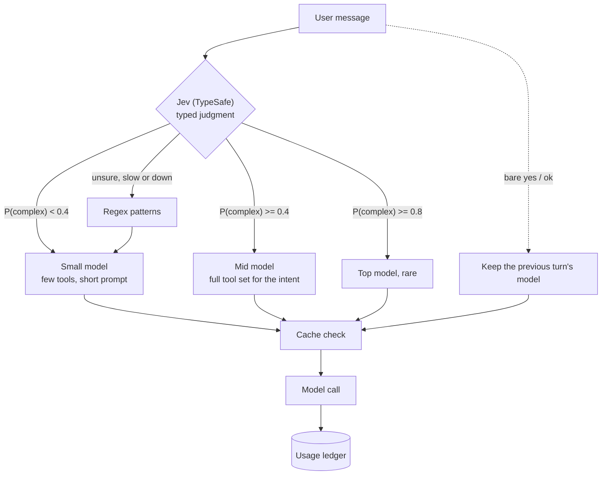

Every AI feature I have shipped looked great in the demo. One person, one clean question, a big model, a fast answer. Then real people start using it. They ask "ok" and "thanks" and "what about the other one?", they paste a whole spreadsheet, they open the same explanation five times a day. The bill climbs, latency drifts past the point where people wait for it, and a few answers come back wrong in ways nobody notices for a week.

Over the last year I built assistants for a learning platform, a property management system, an acquisitions tool and a marketing platform's copilot. The same handful of habits kept them affordable. None of it is clever. Most of it is refusing to send the model things it does not need.

## Route by difficulty, and measure the router

The first mistake is picking one model for everything. Most messages are easy. "Show me last week's attendance" does not need the biggest model you have access to, and "yes" definitely does not.

So every assistant I run now starts with a classifier. Mine is Jev, a small typed-judgment model from TypeSafe AI: instead of chatting, it returns a probability I can branch on. It decides how hard the request is, and that decision picks the model, the tools and the instruction modules for the turn. If Jev is down, slow or unsure, the router degrades gracefully to plain regex pattern matching, so a sick dependency never blocks a message.



Those thresholds are the ones I use on the property system. On the learning platform the ceiling is lower: small model first, mid model at most, and the top tier is not on the menu at all. Teachers asking about rosters do not need it, and taking it off the menu means nobody can get there by accident.

The "keep the previous model on a bare yes" rule came from watching logs. A user would ask something hard, the assistant would propose a plan, the user would type "yes", and the router would see a one-word message and drop to the small model right when the real work started. Short confirmations inherit.

Here is roughly what the decision looks like. This is a sketch, not the production code:

```ts
// sketch
async function route(msg: string, prev?: Route): Promise<Route> {
  if (isBareConfirmation(msg) && prev) return prev;

  // Jev returns a typed judgment: P(complex) plus a confidence
  const p = await jev.judge(msg, { timeoutMs: CLASSIFY_TIMEOUT_MS }).catch(() => null);
  if (p === null || p.confidence < MIN_CONFIDENCE) {
    return routeByPatterns(msg); // regex: dumb, fast, always available
  }
  if (p.complex >= 0.8) return TOP;
  if (p.complex >= 0.4) return MID;
  return SMALL;
}
```

On the marketing copilot the chain has one more step: a typed decision call first, a small chat model if that fails, then regex. If the decision tier keeps failing, it gets skipped for a cooldown period. Otherwise one sick dependency adds a timeout to every single message.

I did not pick the classifier on vibes. I wrote 30 questions, labelled each one, and ran them through two candidates. Jev got 27 of 30 right at a 303 ms median. Using the small chat model as the classifier got 29 of 30, but at a 1,481 ms median and about 3.5 times the cost per decision. Two more correct answers did not justify adding over a second to every message, and the regex rules still catch the cases where the typed model is off, slow or unsure. Those numbers are from my own run, recorded in the commit.

I ran the same kind of test on extended thinking for the small model. On a staging A/B of 28 questions, thinking off got 28 right and thinking on got 27. With it off, model time was 8% lower, output tokens 10% lower, and the median request 6% cheaper. So it is off. I expected thinking to help, and on that workload it simply did not.

That is the whole point of benchmarking before you switch: my intuition was wrong twice, in opposite directions.

## Put prompt caching breakpoints where the prefix stops changing

Tool-heavy turns are where cost hides. The acquisitions assistant pulls comps over several rounds of SQL, and every round replays the system prompt, the tool definitions and all the history so far. Without caching you pay for that prefix again on every hop.

Prompt caching only pays off if the cached prefix is stable, so where you put the breakpoints matters. I put one at the end of the replayed history and one on the newest message. The system prompt and tools sit at the front and never move. History only grows at the end, so the previous turn's prefix is still a valid cache hit. The newest message's breakpoint means the next tool round inside the same turn reads it from cache too.

With that, plus the output shaping in the next section, tool-heavy turns got 48% cheaper in my measurements.

I looked at server-side clearing of old tool results and decided against it for that assistant. Answers there are built from comps collected across several rounds, so the model needs those results. Clearing them also rewrites the prefix, which throws away the cache you just paid to build. For long general chats elsewhere I do use context editing: old tool results get cleared past 30K input tokens, and the conversation is compacted into a summary past 60K. Which one you pick depends on whether old tool output is evidence or just leftovers.

## Cache results by a hash of exactly what the model reads

Some features are pure functions of their input. "Explain with AI" on a record is one: same data, same explanation. People click it over and over.

I cache those by hashing exactly the payload the model will see, after all the shaping and redaction, plus the prompt version and model:

```ts
// sketch
const payload = buildExplainInput(record);      // ids, not names
const key = sha256(JSON.stringify({
  v: PROMPT_VERSION,
  model: route.model,
  payload,
}));
const hit = await cache.get(key);
if (hit) return hit;
```

Hashing the record id instead would be a bug. The record changes, the key does not, and you serve a stale explanation with full confidence. Hashing the model input means the cache invalidates itself the moment anything the model would read changes, and never otherwise. In my measurements a fresh explanation took 19 s and a cached one 2.5 s.

Building the payload this way had a second benefit. Since I was already deciding exactly what goes in, I swapped people's names for ids. Personal data never reaches the model, and the hash does not change just because someone fixed a typo in a name.

The marketing copilot does a cheaper version of the same thing: its to-do suggestions are stored in team metadata, so they are not regenerated on every page visit.

## Shape tool output to a token budget

A SQL tool asked for comps will happily return every matching row. The model uses a handful of them, and you pay for all of them.

Every data tool I write now trims its output to a size budget before it goes back to the model. The part people skip is reporting the true count. If the tool returns a trimmed slice and only says "here are the rows", the model will tell the user that slice is everything. So the result always includes the real total and a note that it was cut.

Short-term memory gets the same treatment. The copilot keeps a token-capped window of recent turns in Redis and drops filler like "ok" and "thanks" before it takes up space.

Output budgets matter too. On the learning platform, AI grading sends only the questions a human would otherwise mark, and the output budget scales with how many there are. A 62-question paper is what exposed this: it ran out of room and surfaced as a misleading parse failure. Now truncation is reported as truncation.

## Spend limits, and what happens when they hit

Every call writes a row to a usage ledger: who, which feature, which model, tokens in and out, cache reads. Without that, every other optimization is a guess.

On top of the ledger:

- A monthly budget per app, with a notice at 80% and a pause at 100%.
- Per-person rate limits on Redis, daily message limits and message length caps.
- On the marketing platform, a balance check before auto-replies, image generation and campaigns, with cost recorded per agent run against the team.
- API callers can never trigger model spend. Only signed-in people in the app can.

The failure mode matters as much as the limit. A paused assistant says so plainly, and the rest of the app keeps working. A router whose classifier is down falls back to keywords. Nothing about running out of budget should look like a crash.

## The checklist I use now

Before an AI feature ships, I go through this:

1. Is there a classifier in front, and did I benchmark it on labelled examples for accuracy, latency and cost?
2. Do short confirmations keep the previous route?
3. Is the top model actually needed for this feature, or can it be left off?
4. Are cache breakpoints after the stable prefix and on the newest message?
5. Is any repeatable output cached by a hash of the exact model input?
6. Does every tool trim to a budget and report the true count?
7. Do output budgets scale with the work, and is truncation reported as truncation?
8. Is every call in the usage ledger, with an 80% notice and a 100% pause?
9. Did I run an A/B on staging before changing a model or a setting like thinking?

It is a boring list. The features that skipped it are the ones I ended up rewriting.
