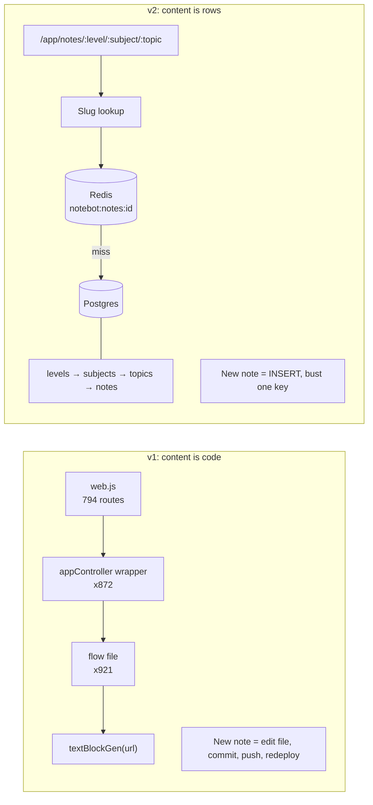

I started NoteBot in 2018 as a Messenger bot for BUTEX students who wanted their notes at 2am without begging a senior on Facebook. It has handled 4,738,209 requests since. For most of that time, every note a student could open existed as a line of JavaScript I had written, committed and deployed.

This post is about engine v2, the rewrite that moved all of that content into PostgreSQL, and about what changed once a note stopped being code.

## How v1 got that way

v1 was a Node and Express app built on the Messenger Platform docs. A controller matched keywords in an incoming message and replied with a "flow": an array of message blocks. I wrote small generators so I couldn't send Facebook a malformed object, things like `textBlockGen`, `webBtnBlockGen` and `groupedBtnBlockGen`. A topic was a file. Here is most of the one for chemical bonding in Chemistry I (URLs shortened):

```js
let textBlockGen = require("../../../../../../../genrators/textBlockGen");

<figure><figcaption>NoteBot v2: one Postgres-backed engine behind the bot, web app, Android app and MCP servers.</figcaption></figure>

let chem1Bond = [
    textBlockGen(`🔷 Hand Note(Tripto,IPE-44,2018)-\n\nhttps://drive.google.com/file/d/1LIt.../view`),
    textBlockGen(`🔷 Hand Note(Nihat,YE-46,2021)-\n\nhttps://drive.google.com/file/d/1JE6.../view`),
    textBlockGen(`🔷 Hand Note(Hafiza, AE-48 ,2023)-\n\nhttps://drive.google.com/file/d/1wwG.../view`),
    textBlockGen(`🔷 Sheet(Azmal Sir, 2019)-\n\nhttps://drive.google.com/file/d/1cL8.../view`),
]

module.exports = chem1Bond;
```

Look at the seven `../` segments. That's the folder tree telling you something.

I'd still make the same call early on, and I mean that. With one developer, no budget and one channel, a JS array is the fastest CMS there is. There's no schema to design, and the only thing to host is one Node process. The whole corpus sits in memory, so a lookup is an array index. When we later added a mobile app and a website, I wrapped the same flows in web handlers and registered a route for each. That worked too, for a while.

## Where it hurt

By the time I measured it properly, v1 had 2,043 files and 44,908 lines in `src/`. 83% of those lines were content and the wiring around it: 921 flow files, 872 per-subject web wrappers, and 221 keyword files. The route table was 794 `router.get` calls, hand-written, in a single 1,158-line `web.js`:

```js
router.get("/app/notes/1/ntf/ntf_silk_flow", appController.ntfSilkFlow);
router.get("/app/notes/1/ntf/ntf_sisal_flow", appController.ntfSisalFlow);
router.get("/app/notes/1/ntf/ntf_hemp_flow", appController.ntfHempFlow);
router.get("/app/notes/1/ntf/ntf_cotton_flow", appController.ntfCottonFlow);
```

Adding one note meant finding the right file among 921, keeping to Messenger's limit of three buttons per group, then commit, push, redeploy. A new subject needed a flow file, a wrapper and a route. Forget the route and the button still renders while the page 404s. When I audited v1 there were 12 routes returning 404 and 13 buttons emitting payloads nothing handled. Twenty-five bugs, every one of them the kind that comes from wiring things by hand.

Button titles were the quieter problem. Meta allows 20 characters per button title. My generator cut at 15, and for years I didn't notice, because truncation wrote a warning to a log nobody read. One full corpus load produced 427 truncation warnings. After I fixed the limit it dropped to 50, and those 50 are titles that really are too long. Worse were the two button groups where the extra buttons were dropped entirely. The content was in the repo and no student could reach it.

Then there's the boot cost. Loading the content graph took 751 ms and added 24 MB of heap on every start, every deploy, every restart. Fine for one process, but I was paying it for content that changed weekly.

## The v2 data model

v2 runs on Bun with Express, PostgreSQL through Drizzle, and Redis through ioredis. The core is a plain hierarchy:



A note is a row with a `topicId`, a title, a URL, a sort order and a `jsonb` metadata column for author, batch, year and department. Routes resolve by slug, so v2 has 32 route registrations where v1 had 794. The `src/` directory is 58 files and 4,825 lines, and all of it is mechanism. The content adds zero lines because it isn't in the repo anymore.

That matters more than the line count. A non-developer can now add a note through the CMS. The CMS resolves or creates the level, subject, topic and note chain in one transaction and invalidates the exact cache keys that changed. No file, no commit, no deploy.

## Migrating without turning the bot off

Students use NoteBot during exams, so a weekend outage was never an option. v1 stayed live the whole time while v2 took over piece by piece, starting with the app API behind the website and mobile app. The Messenger bot was the last and hardest part, because v1's keyword matching is first-match-wins substring matching across ordered branches, so branch order is part of the behaviour.

New content kept arriving during all this, so I planned a dual-write window of about two months. Students submit notes through a Google Form. An n8n workflow copies each file into a Drive we own (copy, never move, so a submitter deleting their file doesn't break the link) and stages a row in a `submissions` table. An agent classifies the row and opens a pull request that edits the v1 flow file and writes a `manifest.json`. When I merge, a GitHub Action inserts the same notes into v2 and busts the cache. One approval updated both engines, and if I rejected the PR, neither changed. It felt clumsy to keep writing into v1 source files while trying to retire them, but it meant the two engines never drifted while both were serving students. Since 11 May 2026 the pipeline has staged 186 submissions and published 139.

The ugliest bug of the migration came from a shortcut. To get parity fast, I'd stored snapshots of v1's rendered output as JSON blobs on subject rows, and the compat routes returned those blobs before ever touching the database. 74 of 136 subjects had one. For 54% of subjects, a note added through the CMS was invisible. The fix was an import-then-drop: pull everything the blobs knew into real rows (675 direct-link topics, 168 entries the blobs had been hiding), take labels from the v1 source files because the blobs carried the old 15-character truncation, then delete the blobs. Lab reports had the same problem on a different table, which I only found when two newly ingested reports landed correctly in the database and still couldn't be seen. There's now a standing check that fails if any snapshot key exists.

## Caching with Redis

The cache is intentionally boring. Each service reads a key, falls back to Postgres on a miss, and writes the result with a one-hour TTL:

```ts
async get<T>(key: string): Promise<T | null> {
  try {
    const data = await redis.get(KEY_PREFIX + key);
    if (!data) return null;
    return JSON.parse(data) as T;
  } catch {
    return null;
  }
},
```

Every Redis failure returns null, so if Redis goes down, requests get slower instead of erroring. The TTL is a backstop. Writes invalidate the specific keys they touch, and there's a scoped flush endpoint for writes that happen outside the CMS.

One lesson I learned the annoying way: there were three cache layers and a "clear cache" button only reached one. The web app persisted React Query data to `localStorage` for 24 hours with refetch-on-focus off, so a student could see a stale page while the database and Redis were both correct. Server-side flushes can't reach a browser's storage. I ended up bumping a `CACHE_VERSION` constant to force it.

## What the numbers show

v2 is slower per request, and I'm not going to pretend otherwise. v1 answered `/app/notes/1/math1` in about 3 ms on localhost because there's no I/O on that path. v2 answers the same route in about 65 ms warm, measured live with roughly 75 ms of round-trip on that connection, so most of that figure is network. With the cache flushed, a cold request averaged 85 ms against about 72 ms warm. Redis saves roughly 13 to 20 ms a request. That's modest, because the tree queries are small and indexed.

The gains are elsewhere. v1 had no search at all, only keywords. The analytics schema logged 10,294 misses across 4,424 distinct terms. "Knitting", missed 169 times on v1, now returns five notes from `/app/search`. Six of the ten most-missed terms resolve. Four still return nothing, because those subjects exist only as subject-level links that the search index doesn't reach.

## What I'd do differently

Write the tests first. Neither engine has a single test, and "v2 matches v1" still rests on parity scripts and spot checks. A compat harness is designed and unbuilt, and every bug I described above would have been cheaper with it.

Put unique constraints on slugs from day one. `subjects.slug` and `topics.slug` aren't unique in the schema, so a case-sensitive lookup once created a duplicate `iae` next to the real `IAE`. Those duplicates are still there.

Don't ship shortcuts that read like the source of truth. The snapshot blobs got me parity in days and then quietly hid new content from students. I'd rather have shipped v2 later with the database as the only source.

And I'd swap `redis.keys` in the pattern delete for `SCAN` before traffic gives me a reason to.

v2 has more moving parts: Node, Postgres and Redis instead of one process. Three things can fail. I still think it was the right trade. The costliest thing in NoteBot was my own time, spent editing JavaScript arrays every time a student shared a hand note, and v2 gave that back.
