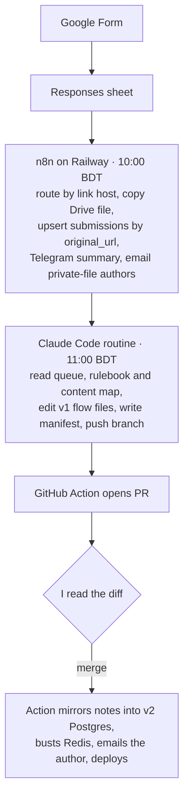

I started BUTEX NoteBot in 2018 to get study notes to students at the Bangladesh University of Textiles. The students write those notes too. They fill in a Google Form, paste a link to their file, and pick a level, subject and topic. Then the file has to end up in the right place in the bot, the web app and the Android app.

<figure><figcaption>The whole pipeline, from a student's form submission to a merged note.</figcaption></figure>

For years, "the right place" meant me. I'd open the link, check it was actually shared, figure out which file in the v1 codebase it belonged in, add a line of JavaScript, commit, push and redeploy. v1 keeps its content as code, spread across 921 flow files with names like `chem1Complx.js` (that one is "Coordination compound"). It's slow work and easy to put off, so I put it off. When the new pipeline did its first real run in July 2026, it staged 133 submissions that had piled up over roughly two months.

This post walks through what replaced me, where the AI sits in it, and the one step I refused to automate.

## The shape of it

There are three lanes, joined by a Postgres staging table and a GitHub pull request.



The first version ran weekly. Now n8n stages every morning at 10:00 Dhaka time and the Claude routine runs an hour later.

## Stage one: collect and secure the file

The form has no file upload. Students paste a URL, which means everything downstream depends on how they shared it. So the first thing n8n does with each new row is work out what kind of link it's holding. This is the actual routing code from the "Parse & Route" node, trimmed:

<figure><figcaption>Nothing reaches students until a person reviews and merges the change.</figcaption></figure>

```js
const url = (r['Link of the Note(URL)'] || '').toString().trim();
let host = 'other', fileId = null, folderId = null;
if (/youtube\.com|youtu\.be/.test(url)) host = 'youtube';
else if (/drive\.google\.com|docs\.google\.com/.test(url)) {
  const fm = url.match(/\/folders\/([a-zA-Z0-9_-]+)/);
  if (fm) { host = 'gdrive-folder'; folderId = fm[1]; }
  else { host = 'gdrive'; const m = url.match(/\/d\/([a-zA-Z0-9_-]+)/) || url.match(/[?&]id=([a-zA-Z0-9_-]+)/); fileId = m ? m[1] : null; }
}
else if (/dropbox\.com/.test(url)) host = 'dropbox';
else if (/1drv\.ms|onedrive\.live|sharepoint/.test(url)) host = 'onedrive';
else if (/camscanner|caij\.cc/.test(url)) host = 'camscanner';
```

A plain Drive file gets copied into NoteBot's own Drive and the copy is set to "anyone with the link". I copy and never move. Moving a Drive file doesn't change who owns it, so if the student later deletes their original, a moved file disappears for everyone. A copy belongs to me, and the student's original stays exactly as they left it.

I also went with OAuth as my own Google account instead of a service account, which surprised me a bit at first. Read access is identical either way: if the student didn't share the file, neither can read it. The difference is storage. A bare service account has essentially no Drive quota, so `files.copy` fails unless you're on Workspace with a Shared Drive. My personal account has real quota, and n8n's credential vault takes care of refreshing the token.

Everything that isn't a clean, shared Drive file gets a status instead of a silent drop. A private Drive file becomes `needs-access`, and the author gets an email asking them to switch sharing to "Anyone with the link". Dropbox, OneDrive and CamScanner links raise a Telegram alert naming the platform. Folders wait for a recursive copy. YouTube links are used as-is. Of that first backlog of 133, 72 came through `ok`, 35 were `needs-access`, 13 were folders and 13 were question banks I still had to copy by hand.

Each row then lands in the `submissions` table. The insert is an upsert keyed on the original URL, set up by the script that configures the workflow:

```js
ins.parameters.operation = "upsert"; // ON CONFLICT so one dup url can't fail the whole batch
ins.parameters.columns.matchingColumns = ["original_url"];
ins.continueOnFail = true;
```

That table is the seam of the whole system. n8n only ever writes to it, the AI only ever reads from it, and re-running any stage is safe because a URL can't be staged twice.

## Why n8n plus small Node scripts

I could have written all of this as one service. I didn't want to. Google Sheets, Drive copying, sharing permissions, Telegram and cron scheduling are plumbing, and n8n already has nodes, retries and a credential vault for all of it. What it's bad at is being reviewed. Logic buried in a canvas of nodes is hard to diff.

So the workflow's node logic lives in a Node script, `n8n-update-main.js`, which patches the workflow through n8n's API. The README calls it "the single source of truth for the workflow", and I hold to that. Around it sit a couple of dozen small, single-purpose scripts: one to preview the sheet, one to publish a manifest into v2, one to reconcile v1 against v2, a few to clean up Drive. Most of them are dry-run by default and need `--apply` to write anything. Boring, yes. It also means I can read exactly what a run will do before it does it.

## Stage two: where the AI sits

Classification is the only part where a model earns its place. A student types "Chemical bonding" under "Chemistry I", and somebody has to know that maps to `cehm1Bond.js` (typo and all) in v1 and to a specific topic ID in v2.

This runs as a scheduled Claude Code routine. Its sandbox can only reach GitHub, so a GitHub Action commits the pending queue into the repo as JSON first. The agent reads that queue alongside a content map, built by parsing every button title in the v1 flow files so it can match on the human-readable title and ignore the cryptic filename. It also gets a written placement rulebook, which took me longer to write than any of the code.

The rulebook boils down to: pick the lowest-risk option that fits. If the topic file exists, append one line. If the chapter is new, create the file and its wiring, then flag it for review. If the subject doesn't exist at all, flag it loudly. Lab reports have their own table and never go into notes. Anything ambiguous gets flagged with a reason instead of a guess.

Some rules in it come straight from bugs I shipped. Messenger allows 20 characters per button title and 3 buttons per group, and it truncates or drops anything beyond that without an error. v1 was cutting titles at 15 until I fixed it, which had been producing 427 truncation warnings per corpus load. The agent knows both limits. It also never touches API serialization, because the bot and the app depend on byte-identical output.

When it's done, it writes a manifest of everything it placed and pushes a branch.

## Stage three: a human merges

A GitHub Action turns that branch into a pull request with two tables: Applied, listing each note and where it went, and Flagged, listing what the agent refused to place and why. I get a Telegram ping with the counts and the link.

Then nothing happens until I read the diff and click merge. The AI proposes; merging is the publish button. If I reject the PR, neither backend changes. Since 11 May 2026, zero notes have reached production without that click.

On merge, a second Action mirrors every applied note into the v2 database and invalidates the Redis keys for the topics that changed. Dedup there is by Drive file ID, because the same file keeps arriving with different `?usp=` suffixes:

```js
const fileId = (u) => { const m = String(u).match(/\/d\/([a-zA-Z0-9_-]+)/); return m ? m[1] : String(u); };
// ...
const existing = (await c.query("SELECT url FROM notes WHERE topic_id=$1", [p.topicId])).rows;
const has = existing.some((e) => fileId(e.url) === fileId(p.url));
if (has) { dupes++; continue; }
```

The author gets a "your submission is live" email, and main mirrors to GitLab, which deploys the bot.

## Failure handling, including mine

The rule I care most about: a row is marked `done` only when its URL is actually present in v2. An earlier version of the apply script marked submissions `done` and then skipped them with a quiet `continue` whenever the topic name was empty, which happens for every lab and every subject-level link. Submission 70 was lost that way: marked `done`, present in neither backend. Now labs go to `lab_reports`, subject links go to a "Full Notes" topic, and anything that fails to mirror is marked `v2-failed` and triggers a Telegram warning. It stays queryable instead of vanishing.

Scheduling bit me too. GitHub delays scheduled Actions on this repo by about 3.5 hours, so the queue-preparing workflow carries two cron entries to land inside the window either way. And the n8n cron has no workflow timezone, so it inherits the instance default of New York. When New York leaves daylight saving on 1 November 2026, the 10:00 staging run slides to 11:00 BDT, exactly onto the Claude slot. The fix is pinning the workflow to `Asia/Dhaka`. It's written down as an open item, which is where it belongs until I do it.

## What the v1 to v2 rewrite changed

The pipeline was born during a migration, so for a while it dual-writes: v1 through the PR, v2 through the merge Action. The difference between the two halves says most of what I'd say about the rewrite.

To publish into v1, the pipeline rewrites `.js` source files and commits them. 83% of v1's code is content expressed as code. Adding a new subject also means a flow file, an app controller wrapper and a hand-registered route among 794 of them, and when someone forgets the route, the page 404s while the button still renders. To publish into v2, it inserts a row. v2 went from v1's 2,043 files and 44,908 lines in `src/` down to 58 files and 4,825 lines, and all of that is mechanism.

v2 is slower per request. v1 answers from objects already sitting in memory, and no database-backed service beats that. I'll take the trade, because the expensive thing at NoteBot was never milliseconds. It was me, at a desk, editing JavaScript to add a PDF.

## Where it stands

Since 11 May 2026, the pipeline has staged 186 submissions from 48 students and published 139 of them: 99 notes, 21 lab reports and 19 question banks. 45 are stuck on private Drive links, by far the most common reason a note doesn't go live, and the reason the author email exists.

Claude is the smallest piece of this. Copying the file first, the staging table, the dedup key, a rulebook in plain English, flags instead of guesses, and a merge I can't skip are what make it trustworthy. The AI turned a filing job I kept putting off into a diff I review and merge.
