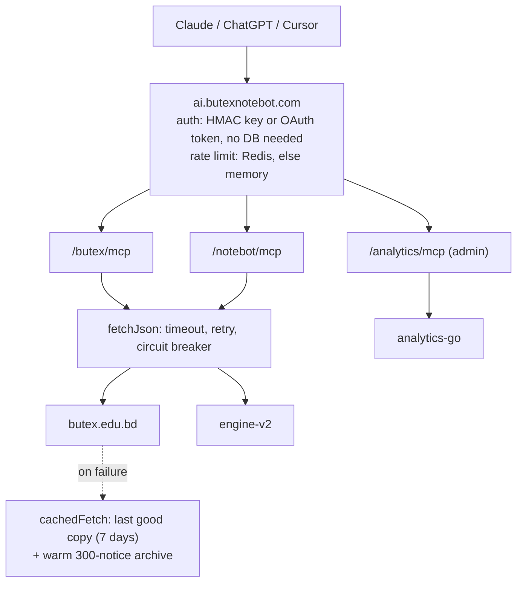

Every BUTEX student I know has the same morning routine during exam season. Open butex.edu.bd, scroll the notice board, tap a notice, wait for a scanned JPG to load, pinch-zoom to find the date of the L-3 T-2 routine. Then do it again tomorrow in case something changed.

<figure><figcaption>A real question about an official BUTEX notice, answered in Claude.</figcaption></figure>

I've run BUTEX NoteBot for eight years. It has notes, books and lab reports, but it never had a good answer to "is there a new routine?", because the notice board isn't ours. This September I fixed that by building NoteBot MCP: a set of MCP servers at ai.butexnotebot.com that let Claude, ChatGPT and other clients read the official notices and NoteBot's study material directly.

This post is about the engineering, and mostly about the parts that exist because things break.

## Why MCP

I could have built another chatbot. I already maintain one, and I didn't want to pay for a model, host a model or tune a prompt that students would outgrow by next semester. The students already have Claude and ChatGPT open. What those assistants lack is access to the BUTEX site and to our notes.

MCP is the standard way to give them that access. I write tools once, and Claude on the web, desktop and phone, ChatGPT, Claude Code, Cursor, VS Code and anything else that speaks Streamable HTTP can call them. The model does the language work; my server does the boring, verifiable part of fetching and citing.

## Three endpoints, one key

There are three servers behind one domain:

- `/butex/mcp` reads the official butex.edu.bd site: notices, results, schedules, plus departments, teachers, offices and halls.
- `/notebot/mcp` wraps notebot-engine-v2: notes, books, lab reports, question banks, syllabus, study plans and recommendations. TexGPT is deliberately left out.
- `/analytics/mcp` is mine alone. It wraps notebot-analytics-go and rejects anything that isn't the admin tier with a 403.

<figure><figcaption>Scanned notices are read for the model, so it can quote dates and rooms.</figcaption></figure>

The stack is small on purpose: Bun, TypeScript, the official MCP SDK in stateless mode with JSON responses, zod and unpdf. No framework. Each request gets a fresh `McpServer`, which means there is no session state to lose when Railway restarts the container.



## Auth that doesn't need the database

Claude and ChatGPT custom connectors can't send custom headers, so they need OAuth. I wrote a minimal OAuth 2.1 server with dynamic client registration and PKCE, and kept it stateless: client ids are signed blobs carrying their redirect URIs, auth codes are AES-GCM sealed blobs carrying the issued key and the PKCE challenge. The access token is a normal NoteBot API key. A student clicks Connect, types an email, presses Allow, and that's it.

Gemini taught me one lesson here. It sometimes re-sends the code exchange when the first response is slow, and a strict "codes are single use" rule left the connector half-linked. Now a repeated exchange from the PKCE holder, before the code expires, gets the same token back.

For clients that take a header, there's a free key from the dashboard. Keys look like `nbk_f_<id>_<sig>`, where the signature is an HMAC over the tier and id. That design choice paid for itself twice.

<figure><figcaption>Every answer links the official notice, and says so when it comes from cache.</figcaption></figure>

First, verification is a pure signature check. Postgres only adds revocation, ownership and usage counts on top, and if it's unreachable, a correctly signed key still works:

```ts
async function isRevoked(id: string): Promise<boolean> {
  const cacheKey = `mcp:revoked:${id}`;
  const cached = await cache.get<boolean>(cacheKey);
  if (cached !== null) return cached;
  const row = await db((sql) => sql`SELECT revoked_at FROM mcp.api_keys WHERE id = ${id}`);
  // DB unreachable → fail open for correctly signed keys (that's the point of signing them)
  if (row === null) return false;
  const revoked = !!(row as { revoked_at: Date | null }[])[0]?.revoked_at;
  await cache.set(cacheKey, revoked, 300);
  return revoked;
}
```

Failing open makes some people nervous. For a read-only server over public university notices, I'd rather a revoked key work for a few minutes during a database outage than lock out every student the night before an exam.

Second, because the signature is deterministic, I can rebuild a key from its id. So when someone types an email that already has a key, the dashboard doesn't show it. It emails the key to that address, along with a one-hour, single-use "replace key" link. Otherwise anyone who knew your email could read your key off my page. Mail scanners pre-fetch links, so the emailed link only shows a confirm page on GET and acts on POST. Free keys get 120 requests a minute and 5,000 a day.

## Degrade, don't die

butex.edu.bd is a WordPress site on a LiteSpeed host. It goes down, sometimes on exactly the days people need it. My rule for the codebase is that an upstream outage should cost freshness and nothing else.

Every upstream call goes through `fetchJson`: an 8 second timeout per attempt, two retries with exponential backoff and jitter, and a circuit breaker per upstream. After three consecutive failed calls the breaker opens for 60 seconds, and calls fail fast instead of stacking timeouts:

```ts
    } catch (err) {
      lastErr = err;
      if ((err as { fatal?: boolean }).fatal) throw err;
      if (attempt < retries) await sleep(300 * 2 ** attempt + Math.random() * 200);
    }
  }

  b.failures++;
  b.lastError = errMsg(lastErr);
  if (b.failures >= FAILURES_TO_OPEN) b.openUntil = Date.now() + OPEN_MS;
```

On top of that sits `cachedFetch`. It serves fresh data when the cache is young, refetches when it isn't, and when the refetch fails it returns the last good copy (kept up to 7 days) with a `stale` flag. Tools turn that flag into a visible line starting with a warning sign, and the server instructions tell the model to say plainly that the site was unreachable. I'd much rather Claude say "this is from cache, the site is down" than silently present old data as current.

Search gets one more layer. A background warmer refreshes the newest 300 notices every 20 minutes. If live search fails, the tools search that offline archive instead, so "any new exam routine?" still has an answer during an outage.

The cache itself degrades too. Redis is the shared store, but every Redis call is time-boxed at 800 ms, and a failure marks Redis down for 30 seconds and falls through to an in-process LRU. Losing Redis costs me cross-instance sharing. Rate limits and caches keep working.

## Tools that never throw

This is the invariant I care about most. A tool that throws an exception at the transport layer gives the model an opaque protocol error, and models handle that badly. They either give up or invent an answer.

So every tool body is wrapped in `guard()`:

```ts
    } catch (err) {
      log.error("tool failed", { event: "tool", tool: name, ms: Math.round(performance.now() - started), ok: false, args, err });
      return {
        isError: true,
        content: [
          {
            type: "text",
            text:
              `${name} could not complete: ${errMsg(err)}.` +
              (hint ? `\n${hint}` : "\nTry again shortly, or narrow the request."),
          },
        ],
      };
    }
```

The model gets an `isError` result in plain English with a hint it can act on, like "check the id came from butex_* tools; you can always give the user the notice link directly." Pair that with server instructions that say "retry once with simpler arguments, then switch tools", and a failed call becomes a detour. The conversation keeps going. Every tool is also annotated read-only, so neither Claude nor ChatGPT asks for confirmation before calling it.

## Reading scanned notices

Here's the uncomfortable fact about the BUTEX notice board: the content isn't text. About 80% of notice bodies are a scanned JPG and about 20% are a PDF. Only the title, date and category are machine-readable.

I didn't want to run OCR on a small Railway container. Models are good at reading images now, so `butex_read_notice` downloads the mid-size preview of the scan (capped at 1.8 MB, and only from butex.edu.bd hosts) and returns it as an MCP image block, followed by a line telling the model the image is the official notice and to quote dates exactly. PDFs go through unpdf for their text layer, cached for a week. A PDF with no text layer gets reported honestly as a scan with a link, because guessing a date from nothing is the one thing this server must never encourage.

## ChatGPT wants search and fetch

ChatGPT connectors and deep research look for two tools by exact name: `search` and `fetch`. So the BUTEX server exposes them alongside the `butex_*` tools. `search` returns ids, titles and URLs as JSON; `fetch` returns the notice text plus any extracted PDF text. Text is all that pair carries, so for a scanned notice `fetch` says so and points at the link. In Claude, the richer `butex_read_notice` with images does the job.

## What the site audit showed

Before writing any tools I audited butex.edu.bd. The good news: the WordPress REST API at `/wp-json/wp/v2/` is open, with server-side search, date filters and pagination. That's 3,458 notices across 56 categories, going back to 2017, with no HTML scraping. Academic Notices alone holds 1,109 posts and Published Results 479.

The bad news was more interesting. There's no structured routine, timetable or exam calendar anywhere. Routines are just notices. Level and term are spelled every way possible (`L-2 T-1`, `L2-T1`, `Level-2 Term-I`, even `L3-Tl`), so matching normalises them, and because WordPress search matches whole words, `L2T1` finds nothing and the server retries fuzzily over the newest ~300 notices. Titles come HTML-encoded. Body links use `http://`. Asking for a page past the end returns HTTP 400, which I treat as an empty page rather than an outage.

The 230 site pages were worse: their REST body is empty because a page builder renders them, so department, faculty, office and hall data comes from parsing the rendered HTML. Some pages are empty templates with only a banner. Some faculty cards list personal Gmail or Yahoo addresses; the parser drops those and keeps only `@butex.edu.bd` ones.

I also try to be a polite guest. Notice lists are cached 10 to 30 minutes, pages 12 hours, and the people index reads about 40 pages, 4 at a time, at most twice a day.

## What I'd tell anyone building one

Spend less time on the tool list and more on the failure path. Students forgive a stale answer that admits it's stale. They don't forgive a confident wrong exam date, and neither would I.

NoteBot is an independent, community-driven project, not an official BUTEX service. If you're a BUTEX student, add `https://ai.butexnotebot.com/butex/mcp` as a connector and ask it about your next routine. Then check the linked notice anyway.
